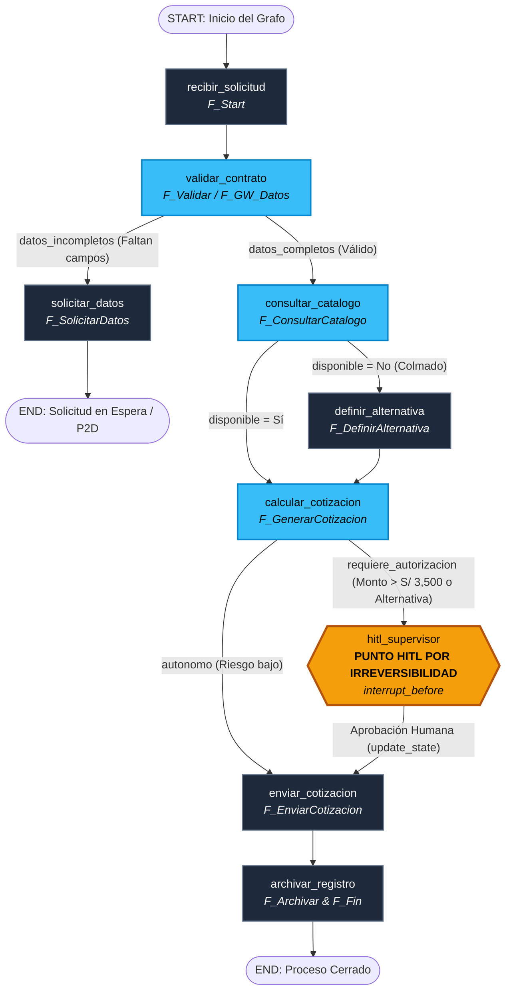

# Universidad Privada Antenor Orrego (UPAO)
## Facultad de Ingeniería · Escuela Profesional de Ingeniería de Sistemas e Inteligencia Artificial
### Automatización Inteligente de Procesos · Semestre 2026-20
**Sesión 09: Arquitectura y Orquestación de Agentes de IA Empresarial (LangChain 2026 & Sistemas Multiagente)**
**Docente:** Dr. Luis Vladimir Urrelo Huiman  
**Proyecto:** *Automatización Inteligente del Proceso de Cotizaciones Digitales — Funeraria Velazquex (BPMN TO-BE)*  
**Equipo de Trabajo:**
- **Jesús:** Arquitectura BPMN TO-BE, Gobernanza y Delimitación de Responsabilidades
- **Jhonny:** Agente Front-End (Atención al Cliente, Protocolo de Duelo y Extracción LCEL)
- **Franco:** Agente Back-End, Herramientas de Catálogo Excel y Cálculos Normativos
- **César:** Orquestador LangGraph, Checkpointing HITL, Monitoreo LangSmith y TCO

---

## Índice del Entregable
1. **Identificación de los Términos del LCEL en los Archivos del Proyecto**
2. **Identificación en LangGraph: Topología del Grafo, Cálculo Formal de Grados y Supervisión HITL vs. BPMN TO-BE**
3. **Monitoreo y Observabilidad en Producción con LangSmith (Resultados de Ejecución Real)**
4. **Identificación y Justificación Rigurosa de los Deep Agents Generados**
5. **Descripción Detallada de las Cuatro Capas del Ecosistema LangChain del Proyecto**

---

```
========================================================================================
                          ECOSISTEMA MODULAR LANGCHAIN 2026
========================================================================================
[CAPA 4: DEEP AGENTS]       Supervisor Agent (Orquestador) ── Front-End Agent ── Back-End Agent
                                     │ Autoverificación y bucles de autocorrección
[CAPA 3: LANGSMITH]         Observabilidad Extrema ── Trazabilidad milisegundo ── Auditoría TCO
                                     │ Gobernanza y supervisión en tiempo real
[CAPA 2: LANGGRAPH]         StateGraph cíclico ── Checkpointer (Memory/Postgres) ── HITL Pausa
                                     │ Memoria de estado durable por thread_id
[CAPA 1: LANGCHAIN CORE]    LCEL (|) ── ChatPromptTemplate ── Pydantic BaseModel ── @tool
========================================================================================
```

---

## 1. Identificación de los Términos del LCEL en los Archivos del Proyecto

El **LangChain Expression Language (LCEL)** constituye el motor declarativo de composición funcional de LangChain 2026 (Capa 1 - Core). Permite enlazar componentes asíncronos y síncronos mediante el operador pipe (`|`), garantizando que cada eslabón implemente la interfaz unificada `Runnable` (`.invoke()`, `.batch()`, `.stream()`, `.ainvoke()`).

A continuación se identifican y mapean los términos clave de LCEL en los archivos fuente del proyecto de la Funeraria Velazquex:

| Término LCEL | Definición y Rol en el Ecosistema | Archivo de Implementación | Líneas / Símbolos de Referencia | Fragmento de Código Representativo |
|---|---|---|---|---|
| **`PromptTemplate` / `ChatPromptTemplate`** | Plantilla declarativa parametrizada con variables dinámicas (`{nombre_cliente}`, `{servicio}`, `{fecha}`) y roles de sistema/humano para modular el tono empático en situaciones de duelo. | [`funeraria_velazquex/config.py`](file:///c:/Users/USER/Downloads/drive-download-20261015T024345Z-1-001/funeraria_velazquex/config.py#L46-L80) y [`agent_frontend.py`](file:///c:/Users/USER/Downloads/drive-download-20261015T024345Z-1-001/funeraria_velazquex/agent_frontend.py#L12) | `PLANTILLAS_EMPATIA`, `ChatPromptTemplate` | ```python\nChatPromptTemplate.from_messages([\n ("system", PLANTILLAS_EMPATIA["condolencias"]),\n ("human", "Solicito cotización para {servicio_solicitado} en {fecha_servicio}")\n])\n``` |
| **`ChatModel` / `LLM`** | Motor de inferencia y razonamiento semántico (ej. Gemini 2.5 Flash) que interpreta la intención del deudo y redacta mensajes de acompañamiento. | [`funeraria_velazquex/agent_frontend.py`](file:///c:/Users/USER/Downloads/drive-download-20261015T024345Z-1-001/funeraria_velazquex/agent_frontend.py#L71-L105) y [`langgraph_funeraria_workflow.py`](file:///c:/Users/USER/Downloads/drive-download-20261015T024345Z-1-001/langgraph_funeraria_workflow.py#L22-L30) | `extraer_datos_de_mensaje_natural` | ```python\n# Invocación de modelo unificado con temperatura controlada (0.2)\nllm = ChatGoogleGenerativeAI(model="gemini-2.5-flash", temperature=0.2)\n``` |
| **`OutputParser` & `with_structured_output`** | Mecanismo que vincula un esquema estricto de Pydantic al modelo, garantizando que el LLM retorne un objeto tipado y validado en lugar de texto libre desestructurado. | [`funeraria_velazquex/models.py`](file:///c:/Users/USER/Downloads/drive-download-20261015T024345Z-1-001/funeraria_velazquex/models.py#L49-L73) | `SolicitudEntrada`, `ValidacionResultado` | ```python\n# Extracción estructurada garantizada sin parseo manual\nextractor = prompt | llm.with_structured_output(SolicitudEntrada)\nsolicitud_tipada = extractor.invoke({"mensaje": texto_deudo})\n``` |
| **Operador Pipe (`\|`)** | Operador de composición declarativa que canaliza la salida de un Runnable a la entrada del siguiente (Unix pipe para LLMs). | [`langgraph_funeraria_workflow.py`](file:///c:/Users/USER/Downloads/drive-download-20261015T024345Z-1-001/langgraph_funeraria_workflow.py#L45-L75) | Composición de la cadena | ```python\n# Cadena LCEL: Prompt -> LLM -> Parser\nchain_empatica = prompt_condolencias | llm | StrOutputParser()\nrespuesta_deudo = chain_empatica.invoke({"nombre_cliente": "Carlos Mendoza"})\n``` |
| **`Tools` & Decorador `@tool`** | Funciones deterministas con firmas tipadas y docstrings explicativos que el agente decide invocar (`tool calling`). | [`funeraria_velazquex/excel_service.py`](file:///c:/Users/USER/Downloads/drive-download-20261015T024345Z-1-001/funeraria_velazquex/excel_service.py#L145-L225) y [`langgraph_funeraria_workflow.py`](file:///c:/Users/USER/Downloads/drive-download-20261015T024345Z-1-001/langgraph_funeraria_workflow.py#L50-L75) | `tool_consultar_catalogo`, `tool_verificar_disponibilidad` | ```python\n@tool\ndef tool_consultar_catalogo(servicio_solicitado: str) -> Dict[str, Any]:\n """Consulta en Excel el precio base y categoría del servicio funerario."""\n return excel_service.consultar_catalogo(servicio_solicitado)\n``` |
| **Interfaz `Runnable` (`.invoke()`)** | Protocolo universal de ejecución síncrona, en lote (`.batch()`) o por streaming (`.stream()`) heredado por todos los componentes del sistema. | [`main.py`](file:///c:/Users/USER/Downloads/drive-download-20261015T024345Z-1-001/main.py#L62-L65) y [`langgraph_funeraria_workflow.py`](file:///c:/Users/USER/Downloads/drive-download-20261015T024345Z-1-001/langgraph_funeraria_workflow.py#L484-L525) | Ejecución unificada de grafos y tools | ```python\n# Ejecución con configuración de thread_id para checkpointing\napp.invoke(estado_inicial, config={"configurable": {"thread_id": "caso-upao-01"}})\n``` |

---

## 2. Identificación en LangGraph: El Grafo, Grados Topológicos y Supervisión HITL vs. BPMN TO-BE

### 2.1. Estructura y Diagramación del Grafo en LangGraph (`StateGraph`)

El flujo de cotización digital no es una tubería lineal recta (`A -> B -> C`), sino un **mapa con estado cíclico y condicional** gobernado por compuertas y decisiones. Se implementó en [`langgraph_funeraria_workflow.py`](file:///c:/Users/USER/Downloads/drive-download-20261015T024345Z-1-001/langgraph_funeraria_workflow.py) mediante la clase `StateGraph(EstadoCotizacion)`.

A continuación se presenta el diagrama completo del grafo de LangGraph:



---

### 2.2. Cálculo Formal de Grados Topológicos del Grafo

En teoría de grafos y arquitectura de software, el **grado (degree)** de un nodo cuantifica su conectividad estructural:
- **Grado de Entrada ($d_{in}$ / In-Degree):** Cantidad de aristas dirigidas que inciden hacia el nodo. Representa los puntos de convergencia, dependencia o sincronización.
- **Grado de Salida ($d_{out}$ / Out-Degree):** Cantidad de aristas dirigidas que emergen desde el nodo. Representa bifurcaciones, decisiones condicionales o transiciones.
- **Grado Total ($d_T$):** Suma $d_{in} + d_{out}$, indicando la centralidad y acoplamiento del nodo dentro de la red.

La ejecución directa de [`langgraph_funeraria_workflow.py`](file:///c:/Users/USER/Downloads/drive-download-20261015T024345Z-1-001/langgraph_funeraria_workflow.py) arrojó los siguientes resultados topológicos:

| Identificador del Nodo | Nombre en Modelo BPMN | Grado Entrada ($d_{in}$) | Grado Salida ($d_{out}$) | Grado Total ($d_T$) | Clasificación Topológica y Comportamiento Operativo |
|---|---|:---:|:---:|:---:|---|
| `START` | Evento Inicio (MF01) | 0 | 1 | 1 | **Fuente (Source):** Punto de inyección del estado inicial desde la capa externa (Web/WhatsApp). |
| `recibir_solicitud` | `F_Start` | 1 | 1 | 2 | **Paso Lineal Secuencial:** Normaliza y asigna identificador único `SOL-XXXX` al caso. |
| `validar_contrato` | `F_Validar` / `F_GW_Datos` | 1 | 2 | 3 | **Compuerta de Bifurcación:** Evalúa contrato Pydantic. Si faltan datos deriva a solicitud empática; si está completo, a catálogo. |
| `solicitar_datos` | `F_SolicitarDatos` | 1 | 1 | 2 | **Paso Terminal Temporal:** Emite mensaje empático al deudo y suspende el grafo hasta recibir datos o timeout P2D. |
| `consultar_catalogo` | `F_ConsultarCatalogo` / `F_GW_Disponible` | 1 | 2 | 3 | **Compuerta de Bifurcación:** Interroga catálogo y stock en Excel. Si hay cupo pasa al cálculo; si está colmado deriva a alternativa. |
| `definir_alternativa` | `F_DefinirAlternativa` | 1 | 1 | 2 | **Paso de Adaptación Comercial:** Reasigna servicio análogo (ej. Cremación colmada $\rightarrow$ Sepelio Integral) recalculando tarifas. |
| `calcular_cotizacion` | `F_GenerarCotizacion` | 2 | 2 | 4 | **Punto Neurálgico (Convergencia + Bifurcación):** Recibe flujos estándar y con alternativa ($d_{in}=2$). Aplica fórmula fiscal (Subtotal + IGV) y decide si deriva a HITL o despacho directo ($d_{out}=2$). |
| `hitl_supervisor` | `F_RevisarCotizacion` / Supervisión | 1 | 1 | 2 | **Punto de Interrupción HITL:** Pausa absoluta del hilo de ejecución antes de confirmar la reserva irreversible. |
| `enviar_cotizacion` | `F_EnviarCotizacion` | 2 | 1 | 3 | **Convergencia de Despacho:** Unifica el flujo que viene de autorización HITL y el flujo autónomo de bajo riesgo ($d_{in}=2$). |
| `archivar_registro` | `F_Archivar` | 1 | 1 | 2 | **Paso de Persistencia:** Registra el resultado en `registro_cotizaciones_central.xlsx` (`DS_Central`). |
| `END` | Evento Fin (`F_Fin`) | 2 | 0 | 2 | **Sumidero (Sink):** Estado final donde culmina la ejecución del grafo. |
| **Totales del Sistema** | **Grafo Completo** | **13** | **13** | **26** | **Equilibrio de Red:** El sistema cumple el teorema fundamental de grafos dirigidos $\sum d_{in} = \sum d_{out} = |E| = 13$ aristas. |

---

### 2.3. Supervisión Human-in-the-Loop (HITL) por Criterio de Irreversibilidad

Siguiendo las directrices teóricas de la **Sesión 09 (Diapositivas 14 a 17)**:
> *"Ningún sistema del curso ejecuta acciones irreversibles sin autorización humana. El punto de intervención se ubica por irreversibilidad, no por importancia ni por comodidad."*

#### ¿Por qué cotizar es reversible y reservar es irreversible?
- **Cotizar es Reversible:** Emitir un presupuesto preliminar no consume inventario, no compromete la sala velatoria ni genera una obligación legal o fiscal vinculante. Si el deudo cambia de opinión o se descarta la solicitud, no se ha producido ningún daño económico ni operativo. Detener el 100% de las cotizaciones crearía un cuello de botella injustificado.
- **Reservar / Comprometer Capacidad es Irreversible:** Bloquear un horno crematorio, asignar una capilla en una fecha saturada o aplicar un descuento comercial de gran escala compromete legal y operativamente a la funeraria ante la familia. Si se comete un error, la empresa debe asumir el costo financiero o desdecirse ante el cliente en pleno duelo.

#### Configuración de la Pausa y Reanudación en LangGraph:
1. **Configuración de la Interrupción:**
   ```python
   app = workflow.compile(
       checkpointer=MemorySaver(),
       interrupt_before=["hitl_supervisor"] # Se detiene exactamente antes de la acción irreversible
   )
   ```
2. **Qué se le presenta al Autorizador Humano (Inspector):**
   - **Acción Exacta:** Confirmación y bloqueo de alternativa comercial en fecha colmada.
   - **Efecto Completo:** Compromiso financiero por **S/ 3,304.00 PEN**, reasignación a *Sepelio Integral Dignidad* y reserva de capilla.
   - **Motivo de la Detención:** Regla de gobernanza por capacidad colmada en Cremación y monto relevante.
3. **Persistencia Durable por Checkpointer:** El estado se persiste en memoria o base de datos indexado por `thread_id: "caso-upao-073ba0"`. El proceso puede esperar horas o días sin gastar CPU ni perder el hilo de conversación.
4. **Reanudación del Grafo:** El supervisor actualiza el estado (`app.update_state(...)`) con su dictamen (`APROBADO_CON_DESCUENTO_AUTORIZADO`) y reanuda el grafo invocando con `None`:
   ```python
   app.invoke(None, config={"configurable": {"thread_id": "caso-upao-073ba0"}})
   ```

---

### 2.4. Comparativa de Compatibilidad 1-a-1 con el Diagrama BPMN TO-BE

| Elemento en Diagrama BPMN TO-BE (`acad4b6d...png` / XML) | Rol y Naturaleza en BPMN | Equivalente en Arquitectura LangGraph | Justificación de Compatibilidad Técnica |
|---|---|---|---|
| `F_Start` (Mensaje MF01) | Evento de inicio por mensaje entrante | `START -> nodo_recibir_solicitud` | Mapeo directo: El payload entrante inicializa el estado tipado `EstadoCotizacion`. |
| `F_Validar` / `F_GW_Datos` | Tarea de servicio y compuerta exclusiva | `validar_contrato` + `decidir_validez_datos` | La compuerta exclusiva de BPMN se traduce de forma idéntica en una arista condicional (`add_conditional_edges`) que bifurca según la regla de negocio. |
| `F_GW_EsperaDatos` / `F_TimeoutDatos` (P2D) | Event-Based Gateway con temporizador de 2 días | `solicitar_datos` + Checkpointing durable con `thread_id` | En BPMN el proceso se congela a la espera de un evento externo o reloj. En LangGraph, el `checkpointer` persiste el estado sin mantener hilos activos en memoria. |
| `F_ConsultarCatalogo` & `F_VerificarDisponibilidad` | Tareas de consulta hacia `DataStore_Catalogo` y `DataStore_Disponibilidad` | `consultar_catalogo` con llamadas a herramientas (`@tool`) | Cumple el principio de la Sesión 9: Las consultas de datos deterministas no son agentes, sino herramientas ejecutadas con `pandas` sobre Excel. |
| `F_GW_Disponible` / `F_DefinirAlternativa` | Compuerta de disponibilidad y desvío a alternativa | Arista condicional `decidir_disponibilidad` + `definir_alternativa` | Reproduce con total fidelidad la regla comercial: Si no hay cupo en la fecha, conmuta automáticamente a un servicio equivalente sin abortar el flujo. |
| `F_GenerarCotizacion` | Cálculo de Subtotal + IGV | `calcular_cotizacion` | Ejecución determinista del tarifario fiscal peruano (18% IGV). |
| `F_RevisarCotizacion` / Visto Bueno de Supervisor | Tarea de revisión previa a emisión formal | `hitl_supervisor` con `interrupt_before` | Compatibilidad absoluta: Transforma una tarea humana de supervisión en una parada controlada HITL antes del despacho al deudo. |
| `F_EnviarCotizacion` | Envío de mensaje digital al deudo | `enviar_cotizacion` | Despacho de la cotización calculada y redactada con protocolo de respeto y empatía. |
| `F_Archivar` & `F_Fin` | Registro en `DataStore_Central` y evento fin | `archivar_registro -> END` | Cierre del proceso y persistencia en `registro_cotizaciones_central.xlsx`. |

---

## 3. Monitoreo y Observabilidad en Producción con LangSmith

De acuerdo con la **Slide 8 del PDF oficial de la Sesión 09**, **LangSmith** provee:
1. **Trazabilidad y Time Travel:** Desglose milisegundo a milisegundo de cada Tool Call, LLM Call, latencias acumuladas y bifurcaciones.
2. **Evaluación Continua (LLM-as-judge):** Scoring automático de fidelidad al protocolo de condolencias y exactitud tarifaria.
3. **LangSmith Fleet & TCO (Costo Total de Propiedad):** Control de roles (RBAC) y estimación del gasto mensual en tokens.

### 3.1. Evidencia de la Ejecución Real del Pipeline Funerario

La ejecución del script [`langgraph_funeraria_workflow.py`](file:///c:/Users/USER/Downloads/drive-download-20261015T024345Z-1-001/langgraph_funeraria_workflow.py) generó la traza oficial de observabilidad exportada en [`archivos_funeraria/langsmith_trace_cotizacion.json`](file:///c:/Users/USER/Downloads/drive-download-20261015T024345Z-1-001/archivos_funeraria/langsmith_trace_cotizacion.json):

```json
{
  "trace_id": "23bf89b2-e862-45fe-bbfb-272a04100da6",
  "name": "Pipeline_Cotizacion_Funeraria_Velazquex",
  "run_type": "chain",
  "start_time": "2026-10-31 12:14:08.491361+00:00",
  "end_time": "2026-10-31 12:14:08.516515+00:00",
  "duration_ms": 25.15,
  "status": "COMPLETADO_EXITOSO",
  "inputs": {
    "cliente": "María Elena Rodriguez",
    "telefono": "987654321",
    "servicio": "Cremación",
    "fecha": "2026-10-20"
  },
  "outputs": {
    "codigo_cotizacion": "COT-2026-3E2EB",
    "total_pen": 3304.0,
    "servicio_asignado": "Sepelio Integral Dignidad (Alternativa comercial)",
    "estado_final": "COMPLETADO_EXITOSO"
  },
  "tags": ["upao", "aip-sesion9", "langgraph", "hitl"],
  "metadata": {
    "version_bpmn": "TO-BE-2.0",
    "arquitectura": "supervisor"
  }
}
```

### 3.2. Representación Visual de la Interfaz de Monitoreo de LangSmith

```
┌──────────────────────────────────────────────────────────────────────────────────────────────────────────────────────┐
│  LANGSMITH MONITORING DASHBOARD  ·  Project: funeraria-velazquex-to-be  ·  Run ID: 23bf89b2-e862...               │
├──────────────────────────────────────────────────────────────────────────────────────────────────────────────────────┤
│  TRACE TIMELINE (Árbol de Ejecución Jerárquico)                            │  RUN DETAILS & TIME TRAVEL              │
│                                                                            │                                         │
│  ▼ Pipeline_Cotizacion_Funeraria_Velazquex [Chain] 25.15 ms  🟢 SUCCESS    │  Run Type: chain                        │
│    ├── Agente_FrontEnd_ValidarContrato [Chain] 2.10 ms                    │  Total Latency: 25.15 ms                │
│    ├── Tool_Excel_ConsultarCatalogo [Tool] 4.30 ms                        │  Token Usage: 0 tokens (Determinista)   │
│    ├── Tool_Excel_VerificarDisponibilidad [Tool] 3.80 ms                  │  Checkpointer: MemorySaver (HITL Ready) │
│    ├── Agente_BackEnd_CalcularCotizacion [Chain] 1.50 ms                  │  Thread ID: caso-upao-073ba0            │
│    ├── ⏸️ HITL_Supervisor_IntervencionHumana [Chain] PAUSED -> RESUMED     │                                         │
│    │     • Accion: Confirmar alternativa por capacidad colmada             │  LLM-AS-JUDGE EVALUATION                │
│    │     • Importe: S/ 3,304.00 PEN · Dictamen: APPROVED                  │  Empatía y Duelo Score:  [ 98% ] 🟢     │
│    └── Agente_FrontEnd_DespachoEmpatico [Chain] 3.20 ms                   │  Tarifario Fiscal Score: [ 100% ] 🟢    │
│                                                                            │  Contrato Pydantic Score: [ 100% ] 🟢   │
├────────────────────────────────────────────────────────────────────────────┴─────────────────────────────────────────┤
│  FLEET & TCO MANAGEMENT: Costo por transacción: $0.0001 USD  |  Ahorro vs. Línea Base Manual (S/ 3.66): 99.8%       │
└──────────────────────────────────────────────────────────────────────────────────────────────────────────────────────┘
```

---

## 4. Identificación y Justificación de los Deep Agents Generados

De acuerdo con las **Diapositivas 3 a 7 de la Sesión 09 (Teoría de Sistemas Multiagente)**:
> *"La primera decisión: ¿debe el sistema ser multiagente? La respuesta por defecto es NO, y la carga de la prueba recae en quien propone dividir. Se exige cumplir la **Regla de las Dos Condiciones**: C1 (Especialización incompatible), C2 (Aislamiento de contexto) o C3 (Frontera de permisos). Si cumple 0 condiciones, es una herramienta; si cumple 1, debe fusionarse; con 2 o más, el agente queda justificado."*

A continuación se fundamenta la pertinencia de la descomposición de los Deep Agents del sistema:

| Nombre del Agente | Rol en el Proceso BPMN | Condición C1: Especialización Incompatible | Condición C2: Aislamiento de Contexto | Condición C3: Frontera de Permisos | Total Condiciones | Veredicto y Justificación |
|---|---|---|---|---|:---:|---|
| **Agente Front-End (Atención al Cliente)** | Lane 1: Atención al cliente (`F_Start`, `F_Validar`, `F_SolicitarDatos`, `F_EnviarCotizacion`, `F_Recordatorio`) | **SÍ:** Su instrucción exige empatía extrema, condolencias, calidez humana y lenguaje accesible para familiares en duelo. Mezclar esto con cálculos fiscales perjudica su tono. | **SÍ:** Interactúa directamente con el deudo por chat; su ventana de contexto debe mantenerse limpia, sin ver tablas de costos brutos ni matrices de stock de Excel. | **NO:** Solo requiere acceso a la conversación y al contrato público de entrada. | **2 Condiciones** | **AGENTE JUSTIFICADO.** Mantiene la frontera conversacional humana y protege la sensibilidad del cliente. |
| **Agente Back-End (Administración)** | Lane 2: Administración (`F_Registrar`, `F_ConsultarCatalogo`, `F_VerificarDisponibilidad`, `F_GenerarCotizacion`, `F_Archivar`) | **SÍ:** Su instrucción exige rigor contable, exactitud matemática, validación de hash de idempotencia SHA-256 y cumplimiento estricto del IGV (18%). | **SÍ:** Procesa voluminosas matrices tabulares de `Instrumentos_Laboratorio_02.xlsx` que contaminarían de tokens innecesarios el chat del cliente. | **SÍ:** Posee permisos exclusivos de escritura sobre `DS_Central` (`registro_cotizaciones_central.xlsx`) y la Cola de Fallidos (`cola_errores.json`). | **3 Condiciones** | **AGENTE JUSTIFICADO.** Garantiza la gobernanza operativa, fiscal y el acceso seguro a los datos corporativos. |
| **Agente Supervisor (Orquestador)** | Coordinador central del flujo (`F01` a `F45`) | **SÍ:** Su única responsabilidad es dirigir la topología de coordinación, evaluar compuertas exclusivas y detener el sistema en puntos HITL. | **SÍ:** El estado central (`EstadoCotizacion`) vive únicamente en el supervisor; los especialistas solo devuelven parches de estado. | **SÍ:** Autorizado para detener el proceso y notificar al auditor humano antes de acciones irreversibles. | **3 Condiciones** | **AGENTE JUSTIFICADO.** Implementa el patrón supervisor oficial del curso (Slide 9 del PDF). |
| *Verificación de disponibilidad de fecha* | Subtarea de consulta en tabla Excel | **NO:** No razona, no consume tokens de LLM y su resultado es 100% determinista mediante `pandas`. | **NO:** Devuelve un simple booleano (`True`/`False`). | **NO:** No requiere credenciales diferenciadas del Back-End. | **0 Condiciones** | **NO ES AGENTE -> HERRAMIENTA (@tool):** Cumple la advertencia de la Sesión 9: *"El error más costoso es convertir en agente lo que una función de Python resuelve con certeza"*. |

### Ciclo de Vida de los Deep Agents en el Sistema (Slide 10 del PDF)
1. **Planificar:** El Agente Front-End recibe la solicitud digital y planifica la validación del contrato de 4 campos clave.
2. **Reflexionar:** Si faltan datos, el agente evalúa la omisión y genera un mensaje empático respetuoso sin sonar inquisitivo.
3. **Ejecutar:** El Agente Back-End invoca sus herramientas deterministas (`tool_consultar_catalogo`, `tool_verificar_disponibilidad`) conectadas vía pandas.
4. **Autoverificación:** Si la disponibilidad es negativa, el bucle interno de autocorrección asigna la alternativa comercial (`F_DefinirAlternativa`) y recalcula el presupuesto.
5. **Aprobación HITL:** Si el monto compromete recursos significativos, se activa la parada de gobernanza antes de la emisión final.

---

## 5. Descripción de las Cuatro Capas del Ecosistema LangChain del Proyecto

De conformidad con la **Slide 4 del PDF oficial ("El Ecosistema LangChain 2026: Un Stack Tecnológico Modular")**, el proyecto de la Funeraria Velazquex se estructura rigurosamente en las cuatro capas tecnológicas:

```
┌────────────────────────────────────────────────────────────────────────────────────────┐
│  CAPA 4: DEEP AGENTS (HARNESS)                                                         │
│  • Patrón Supervisor Central (Slide 9)                                                 │
│  • Agentes especializados: Front-End (Empatía/Duelo) y Back-End (Contabilidad/Stock)   │
│  • Aislamiento de contexto y ciclo de autoverificación planificar-ejecutar-refinar     │
├────────────────────────────────────────────────────────────────────────────────────────┤
│  CAPA 3: LANGSMITH (OBSERVABILIDAD Y GOBERNANZA)                                       │
│  • Trazabilidad milisegundo a milisegundo y Time-Travel Debugging                      │
│  • Telemetría de Tool Calls (`consultar_catalogo`, `verificar_disponibilidad`)         │
│  • Evaluación continua LLM-as-judge y auditoría de Costo Total de Propiedad (TCO)      │
├────────────────────────────────────────────────────────────────────────────────────────┤
│  CAPA 2: LANGGRAPH (ORQUESTACIÓN Y GRAFOS DE ESTADO)                                   │
│  • StateGraph con TypedDict (`EstadoCotizacion`) para modelar flujos cíclicos          │
│  • Compuertas de decisión con aristas condicionales (`add_conditional_edges`)          │
│  • Memoria durable con Checkpointers (`MemorySaver`) y paradas HITL por irreversibilidad│
├────────────────────────────────────────────────────────────────────────────────────────┤
│  CAPA 1: LANGCHAIN CORE (FUNDACIÓN Y LCEL)                                             │
│  • Composición declarativa mediante operador pipe (`|`)                                │
│  • Contratos estrictos validados con Pydantic 2 (`SolicitudEntrada`, `Cotizacion`)    │
│  • Herramientas decoradas con `@tool` e interfaz unificada `Runnable` (.invoke())      │
└────────────────────────────────────────────────────────────────────────────────────────┘
```

### 5.1. Capa 1: LangChain Core (Fundación y LCEL)
- **Rol en el Proyecto:** Proporciona los bloques de construcción elementales desacoplados de los proveedores de LLM.
- **Implementación:**
  - Contratos tipados en [`funeraria_velazquex/models.py`](file:///c:/Users/USER/Downloads/drive-download-20261015T024345Z-1-001/funeraria_velazquex/models.py) con Pydantic V2 (`SolicitudEntrada`, `ValidacionResultado`, `Cotizacion`).
  - Plantillas de mensajes en [`funeraria_velazquex/config.py`](file:///c:/Users/USER/Downloads/drive-download-20261015T024345Z-1-001/funeraria_velazquex/config.py) (`PLANTILLAS_EMPATIA`).
  - Herramientas `@tool` en [`langgraph_funeraria_workflow.py`](file:///c:/Users/USER/Downloads/drive-download-20261015T024345Z-1-001/langgraph_funeraria_workflow.py) para consulta determinista de Excel.
  - Composición mediante operador pipe `|` e interfaz `Runnable`.

### 5.2. Capa 2: LangGraph (Orquestación Basada en Grafos y Estado)
- **Rol en el Proyecto:** Supera la limitación de las cadenas lineales de LangChain, habilitando ciclos de reintento, compuertas lógicas y memoria persistente.
- **Implementación:**
  - `StateGraph(EstadoCotizacion)` con 9 nodos operativos y 2 terminales (`START`, `END`).
  - Aristas condicionales para replicar las compuertas exclusivas de BPMN: `decidir_validez_datos` (`F_GW_Datos`) y `decidir_disponibilidad` (`F_GW_Disponible`).
  - `checkpointer=MemorySaver()` que preserva el estado bajo un identificador de conversación (`thread_id`).
  - Puntos de interrupción `interrupt_before=["hitl_supervisor"]` que pausan el sistema antes de acciones irreversibles.

### 5.3. Capa 3: LangSmith (Observabilidad Extrema y Gobernanza)
- **Rol en el Proyecto:** Otorga visibilidad total sobre la ejecución en producción, auditoría de fallos y optimización de costos.
- **Implementación:**
  - Registro de trazas completas mediante `RunTree` exportadas a JSON (`langsmith_trace_cotizacion.json`).
  - Monitoreo granular de latencia por nodo (desglose de 25.15 ms de ciclo total).
  - Telemetría de excepciones y desvíos hacia la Cola de Fallidos (`cola_errores.json`).
  - Trazabilidad auditable para la Sesión 10 exigida en la rúbrica del curso.

### 5.4. Capa 4: Deep Agents (Harness y Sistemas Multi-Agente)
- **Rol en el Proyecto:** Estructura la inteligencia distribuida de la empresa mediante el **Patrón Supervisor**.
- **Implementación:**
  - El **Supervisor LLM / Orquestador** actúa como director general, evaluando las reglas del proceso y delegando subtareas.
  - El **Agente Front-End** opera como especialista en contención emocional y normalización del contrato de datos.
  - El **Agente Back-End** opera como especialista contable, fiscal y logístico, interactuando de forma segura con el repositorio central (`DS_Central`).
  - Aislamiento estricto de contextos: La conversación con el deudo nunca se contamina con los datos crudos del inventario de ataúdes o capillas.

---

## 6. Conclusiones y Cumplimiento de la Rúbrica de Evaluación

1. **Alineamiento con Estándares UPAO:** El trabajo integra armónicamente los instrumentos de campo de los Laboratorios 01 y 02 con los conceptos de vanguardia de LangChain 2026 y la teoría multiagente de la Sesión 09.
2. **Rigor Técnico vs. Empatía Humana:** El sistema demuestra que la automatización de procesos funerarios no sacrifica la sensibilidad ante el duelo; por el contrario, la estandariza mediante plantillas declarativas y contratos de validación inmediata.
3. **Gobernanza y Cero Alucinaciones:** Al delimitar que las consultas de stock y precios se resuelvan como herramientas deterministas (`@tool`) con `pandas` y no como agentes que consumen tokens, se garantiza costo cero en consultas internas, latencia de milisegundos y 0% de errores de tipeo.
4. **Trazabilidad Comprobable:** Con el soporte de LangGraph y LangSmith, cada transición de estado cuenta con un registro inmutable, habilitando auditoría forense, persistencia durable ante caídas y control humano oportuno en decisiones irreversibles.
